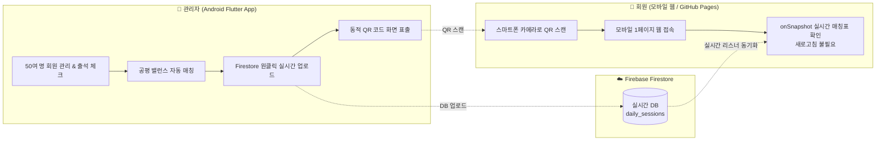

# 🏸 무한랠리 (Infinite Rally GG)
> **배드민턴 동호회 '무한랠리'를 위한 실시간 회원 관리 및 자동 게임 매칭 시스템**

50여 명의 동호회 회원을 효율적으로 관리하고, 출전 기회와 급수를 균등하게 고려한 복식 게임을 자동 매칭하여 체육관 내 회원들에게 실시간 웹 전광판과 QR 코드로 중계하는 모노레포 프로젝트입니다.

---

## 🏛️ 시스템 아키텍처

1. **데이터베이스**: Firebase Firestore (실시간 단일 문서 구독을 통한 읽기 비용 최적화)
2. **관리자용 앱 (`/admin_app`)**: Android (Flutter/Dart), GitHub Actions에서 클라우드 APK 자동 빌드
3. **회원용 웹 뷰어 (`/web_viewer`)**: HTML/Vanilla JS 모바일 반응형 1페이지 웹 (GitHub Pages 자동 배포)

---

## 🚀 현장 운영 프로세스

1. **체육관 도착 및 출석 체크**:
   - 관리자가 앱의 **[회원 관리]** 탭에서 오늘 참석한 회원을 원터치 체크합니다.
2. **공평 자동 매칭 생성**:
   - **[경기 매칭]** 탭에서 사용 코트 수(예: 4코트)를 설정하고 **[공평 자동 매칭 생성]**을 누릅니다.
   - *알고리즘*: 오늘 경기 참여 횟수가 적은 회원을 우선 선발하며, A~초심 급수 합의 차이가 최소가 되도록 2:2 복식 팀을 균형 있게 편성합니다.
3. **Firestore 실시간 업로드**:
   - 하단의 **[회원 웹페이지로 실시간 업로드]** 버튼을 터치하여 DB에 반영합니다.
4. **회원 안내 (QR 코드)**:
   - **[웹 접속 QR]** 탭을 열어 체육관 테이블에 스마트폰/태블릿을 거치합니다.
   - 회원은 기본 카메라로 QR을 스캔하여 모바일 웹페이지에 접속합니다.
5. **경기 진행 및 갱신**:
   - 코트에서 경기가 끝나면 관리자가 **[경기 종료]**를 누르면 해당 선수들의 경기 수가 누적 반영됩니다.
   - 다음 라운드 매칭 시 자동으로 공평하게 다음 순번이 돌아갑니다.

---

## ⚙️ 설정 및 배포 가이드

### 1. Firebase 콘솔 설정
1. [Firebase Console](https://console.firebase.google.com/)에서 새 프로젝트 생성
2. **Firestore Database** 생성 (테스트 모드로 시작 권장)
3. **웹 앱 등록**:
   - `web_viewer/index.html` 파일 내의 `firebaseConfig` 객체에 발급받은 키 입력
4. **Android 앱 등록**:
   - 패키지명: `com.infiniterally.admin_app`
   - 다운로드받은 `google-services.json` 파일을 `admin_app/android/app/` 경로에 저장

### 2. GitHub Pages 활성화 (회원용 웹 뷰어)
- GitHub 저장소 설정: **Settings > Pages**
- **Build and deployment > Source**를 **GitHub Actions**로 선택
- 코드가 `main` 브랜치에 푸시되면 `.github/workflows/deploy-web.yml` 워크플로우에 의해 웹페이지가 자동 배포됩니다.
- 배포된 URL(`https://infinite-rally-gg.web.app/`)을 관리자 앱의 QR 탭에서 확인하면 즉시 동적 QR 코드로 변환됩니다.

### 3. 관리자 APK 다운로드 (GitHub Actions)
- GitHub 저장소의 **Actions** 탭 이동
- **Build & Release Admin Android APK** 워크플로우 선택
- 최신 빌드 결과물 하단의 **Artifacts**에서 `infinite-rally-admin-apk`를 다운로드하여 안드로이드 스마트폰에 설치
- 언제든지 **[Run workflow]**를 눌러 수동으로 즉시 최신 APK를 빌드할 수도 있습니다.

